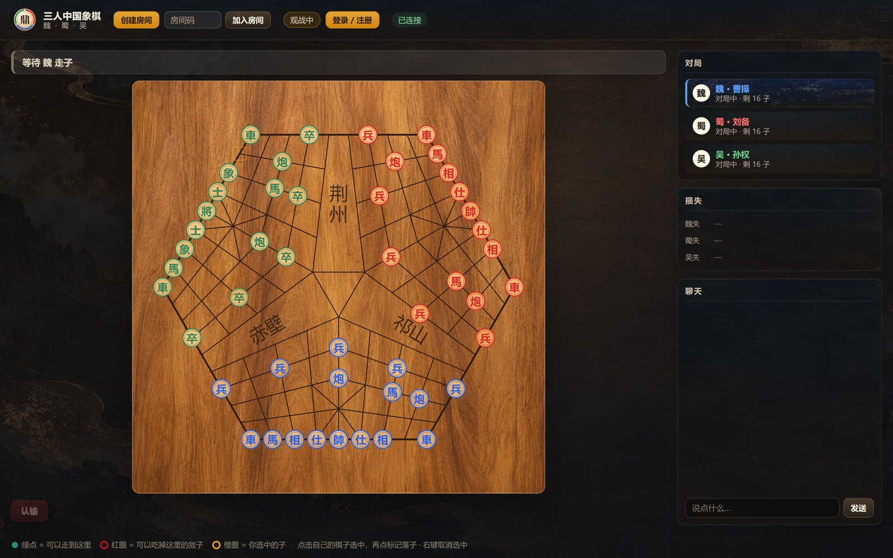
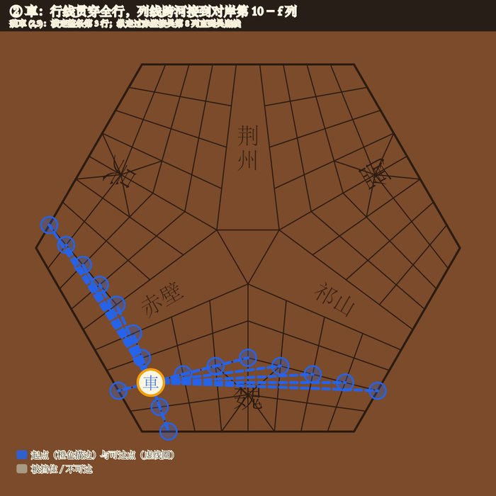
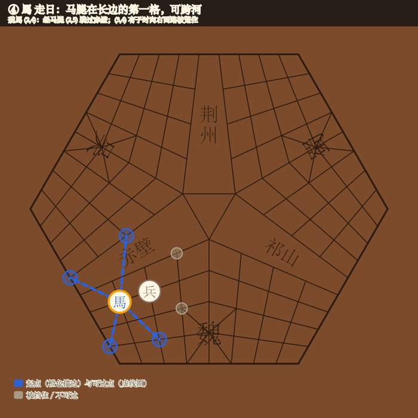
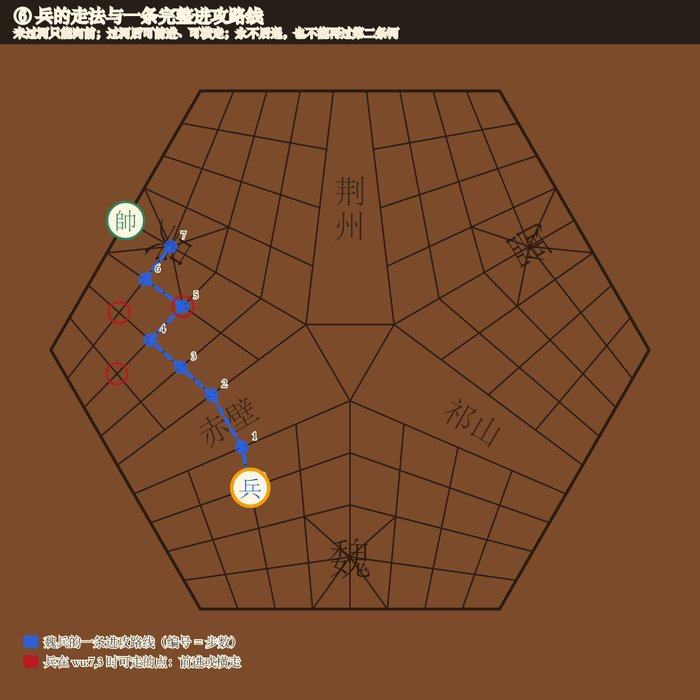

<p align="center">
  
</p>

<h1 align="center">三人中国象棋 · 三国象棋</h1>

<p align="center">
  六边形棋盘上的三人中国象棋，魏、蜀、吴三方实时联机对战。
  <br>
  <a href="https://chess.xylab.site"><strong>在线体验 »</strong></a>
</p>

<p align="center">
  <a href="https://github.com/XuYui/sanguo-xiangqi/actions/workflows/ci.yml"></a>
  <a href="LICENSE"></a>
  = 22.6">
</p>



*Three-player Chinese chess (xiangqi) on a hexagonal board — Wei, Shu and Wu play in real time. The rules map standard xiangqi onto the three-way board; see [docs/rules.md](docs/rules.md).*

## 特性

- **真实棋盘**：从实物「三国象棋」棋盘逆向出 135 个交叉点的精确几何，赤壁、祁山、荆州三条界河与史实方位一致。
- **象棋规则原样映射**：每家就是象棋的半边棋盘，过河就是沿列线前进一步，对岸坐标旋转 180°。
  馬走日、相走田、蹩马腿、塞象眼、炮隔子吃、兵过河可横走、飞将……全部按象棋规则执行。
- **三人对局机制**：被将死或认输的一方出局、棋子移除，其余两家继续，最后存活者胜；支持长将判负、困毙判负。
- **联机**：房间邀请码、自由选座、观战、聊天、断线重连；账号登录后刷新或换设备都能回到原座位。
- **轻量**：前端是原生 HTML/CSS/JS（无构建步骤），后端是一个 Node 进程 + 内置 SQLite，无需 Docker 或数据库服务。
- **可验证**：153 个自动化测试覆盖棋盘拓扑、各棋子走法（含全盘可逆性与三家对称性）、对局状态机与联机协议。

## 规则速览

| 棋子 | 走法 |
|---|---|
| 車 / 炮 | 沿行线或列线滑行；列线可跨河接到对岸第 10 − f 列；炮吃子须隔一个炮架 |
| 馬 | 走「日」，马腿是长边方向的第一格，可跨河 |
| 相 | 走「田」，象眼是对角中点，不过河 |
| 仕 / 帥 | 仕沿九宫斜线走一格；帥在九宫内直走一格 |
| 兵 | 过河前只能前进；过河后可前进或横走；永不后退，也不能再过第二条河 |

<p align="center">
  
  
  
</p>

完整规则见 [docs/rules.md](docs/rules.md)，设计与约束见 [docs/SPEC.md](docs/SPEC.md)。

## 快速开始

需要 **Node.js 22.6 或更高版本**（使用内置的 `node:sqlite` 与 TypeScript 类型擦除）。

```bash
git clone https://github.com/XuYui/sanguo-xiangqi.git
cd sanguo-xiangqi
npm ci
npm run dev
```

打开 <http://localhost:3011>，注册账号后创建房间，把房间码发给另外两位玩家；三席坐满自动开局。
本地想一个人试玩，可以用三个不同的浏览器（或浏览器配置文件）分别注册登录。

## 常用命令

| 命令 | 作用 |
|---|---|
| `npm run dev` | 启动开发服务器（文件变更自动重启），默认端口 3011 |
| `npm run check` | 类型检查 + 全部测试（提交前请运行） |
| `npm test` | 只运行测试 |
| `npm run build` | 构建可部署产物到 `.build/` |
| `npm run board:diagrams` | 由引擎重新生成规则图 `packages/core/diagrams/` |
| `npm run board:export-web` | 重新导出前端用的棋盘几何与底图 |

## 项目结构

```
packages/core/          棋规引擎：棋盘拓扑、走法生成、对局状态机（纯 TypeScript，前后端共用）
  data/                 棋盘几何数据与底图
  diagrams/             由引擎计算生成的规则图
apps/server/            Node HTTP + Socket.IO 服务：房间、观战、账号、SQLite 持久化
apps/web/public/        前端（原生 ES Modules + SVG）
tools/build.mjs         构建可部署产物
tools/deploy_server.py  一键部署到 Linux 服务器（systemd + nginx + Let's Encrypt）
tools/board-generator/  棋盘几何生成器（Python）
docs/                   规则、SPEC、部署说明
```

## 部署

`npm run build` 生成的 `.build/` 是一个只依赖 `socket.io` 的 Node 应用，用 systemd + nginx 即可上线。
详见 [docs/deployment.md](docs/deployment.md)。

## 参与贡献

欢迎提 Issue 和 Pull Request，请先阅读 [CONTRIBUTING.md](CONTRIBUTING.md)。
**规则相关的改动必须同时更新 `packages/core/test/` 里的断言。**

## 致谢

- 站点图标中的「鼎」字字形取自 [思源宋体 / Noto Serif SC](https://github.com/notofonts/noto-cjk)，
  以 [SIL Open Font License 1.1](https://openfontlicense.org) 授权。
- 联机层基于 [Socket.IO](https://socket.io)。

## 许可证

[MIT](LICENSE) © XuYui
